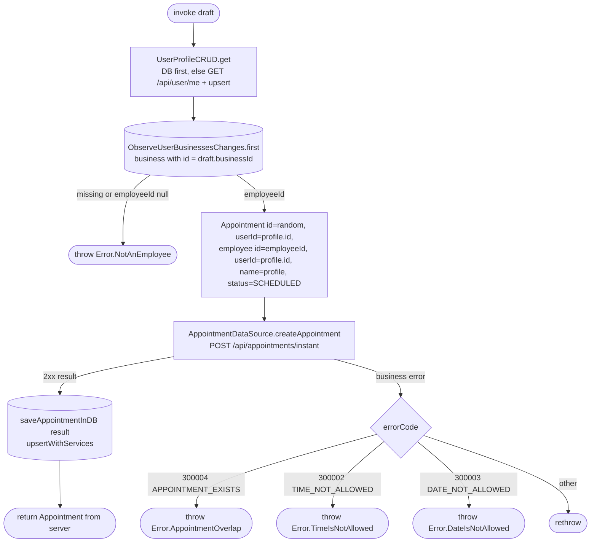

[← Operations](../README.md)

# Create appointment (instant)

`CreateAppointment(draft)` → `POST /api/appointments/instant`
· called from `AppointmentCreateViewModel` and `AppointmentListViewModel`

The id is generated on the client with `Uuid.random()`. The **current user is always the assigned employee**:
`employee.id` is the caller's employee record id in the draft's business, read from the cached `business` row
(`Business.employeeId`, through `ObserveUserBusinessesChanges`), and `employee.userId` is the profile id. The
server stores `employee.id` as sent, and the appointment list filters by it. If that business is not cached or
its `employeeId` is `null` (the caller is not an active employee, or the row predates DB version 19 and was not
refreshed yet), it throws `Error.NotAnEmployee` without calling the server. The server result is saved with `saveAppointmentInDB` in a separate datasource call, so the list screen
redraws from the `appointment` table.

Depends on [User profile CRUD](../authorization/user-profile-crud.md) and [Observe user businesses
changes](../business/observe-user-businesses-changes.md).
