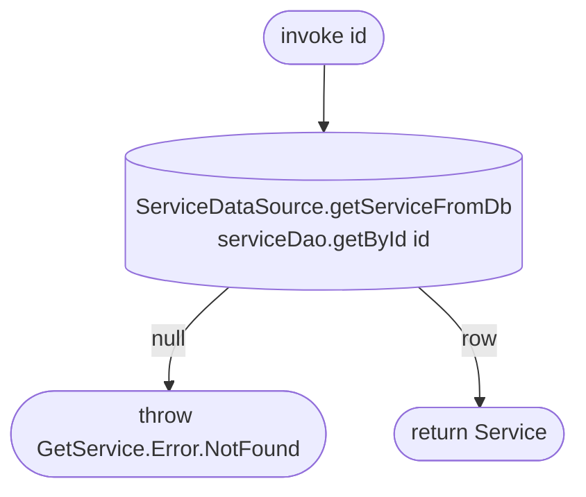

[← Operations](../README.md)

# Get service

`GetService(id)` → **local only**, `serviceDao.getById(id)` · called from `EditServiceViewModel`

Reads the cached `service` row with its group. There is no network call: the services list is synced by
[Get services](get-services.md) before a service can be opened.

